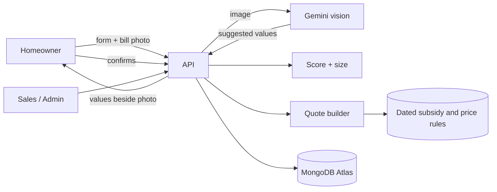

# Solartrack Vidarbha

**Rooftop solar lead qualification, quotation and project tracker** for an installer in Nagpur.

Homeowners answer a few questions and upload an electricity bill. AI reads the bill, the homeowner confirms every value, and a transparent score says who is worth a roof visit and what size fits. Sales staff turn a lead into a quote with subsidy and payback worked out from dated rule tables, then track the project from advance to "Subsidy credited" with a status link the customer can open.

| | |
|---|---|
| **Live app** | https://solartrack-vidharba-1client.onrender.com |
| **API** | https://solartrack-vidharba.onrender.com (health check: `/api/health`) |
| **Source** | https://github.com/ShivamBytes18/Solartrack-vidharba |

> The app runs on Render's free tier. If it has been idle, the first request can take up to a minute while the server wakes up.

---

## Try it

**Homeowner (no login):** open the live app, click **Check my home**, fill the form and upload a bill photo.

**Staff and admin** (demo data only, all people and numbers are fictional):

| Role | Email | Password | Can do |
|---|---|---|---|
| Sales | `` | `` | Leads, quotes, PDF, projects |
| Admin | `` | `` | Everything above, plus Rules and data deletion |

**A 5-minute path**

1. As a homeowner, submit the form with a bill photo. Check the values beside the image, confirm, and see your score and suggested size.
2. Sign in as sales. Open a scored lead, create a quote, and download the PDF.
3. Click **Customer paid advance** to start a project. Advance a stage and see the simulated WhatsApp message.
4. Open the customer status link from the project page.
5. As admin, open **Rules**, add a subsidy version with a future date, and create quotes with different "Rules as on" dates.

---

## Features

**Homeowner**
- Short lead form: owner or tenant, roof type and area, monthly bill, pincode, bill photo, with consent for data use.
- AI bill reading with a **confirm beside the photo** screen. Low-confidence values are flagged, and a poor photo asks for a re-upload.
- Result page with a score, a suggested system size, and the next step (roof visit or short call).
- A private status link that shows project stages and dates, never the consumer number or the bill.

**Sales staff**
- Dashboard: high-score leads, leads to call first, bills awaiting confirmation, active projects, and a list of **stuck projects**.
- Lead detail with the bill image, confirmed values, score reasons and notes. It shows when the customer corrected the AI.
- **Quote builder** for up to five system sizes, with a "rules as on" date.
- Quote page that opens with three numbers (size, cost after subsidy, payback), then the detail. The same layout is available as a **PDF**.
- Project tracker with seven stages from "Advance received" to "Subsidy credited", documents, and simulated WhatsApp messages on every stage change.

**Admin**
- Subsidy rules, price lists and settings, all with **effective dates**. Old rules are never edited, only superseded.
- Delete a customer's data (a DPDP erasure request).

---

## How it works



### The AI part, and what happens when it is wrong

The model **only reads text from the bill photo**. It never decides the subsidy, the generation, the price or the score.

- It returns the consumer number, tariff, sanctioned load, monthly units and bill amount, with a confidence for each field.
- The server validates that output. A poor photo or fewer than two fields read gives a **re-upload** prompt. Implausible numbers are discarded.
- Fields below 75% confidence are highlighted, and **nothing counts until the customer confirms**.
- If the customer changes a value, the correction is stored and shown to sales.
- Network errors, rate limits and overloads are **retried with growing waits**, then an optional backup model is tried. If everything fails, the customer types the values, so an AI outage never blocks a lead.

### Scoring (rule-based, explainable)

| Situation | Score | Next step |
|---|---|---|
| Tenant | Low | Short call |
| Roof under 100 sq ft | Low | Short call |
| Owner, under 100 units a month | Low | Short call |
| Owner, 100 to 249 units | Medium | Roof survey |
| Owner, 250+ units | High | Roof survey |

A Low score **never rejects** a lead. It only replaces the survey with a call. Thresholds are editable in the admin Settings.

### Subsidy and payback (the hard part)

Rules are rows with effective dates, not constants in code. A quote picks the rule in force on its date.

```
subsidy  = min(cap, min(kW, 2) × ₹30,000 + min(max(kW − 2, 0), 1) × ₹18,000)
           → 1 kW ₹30,000 · 2 kW ₹60,000 · 3 kW and above ₹78,000

generation   = kW × 1,400 units a year (editable)
yearly saving = min(generation, the home's own yearly usage) × tariff
tariff        = bill amount ÷ units from the customer's bill (clamped to ₹4 to ₹14)
payback       = net cost ÷ yearly saving
```

**Worked example** (seed data, 3 kW, April 2026 price list): price ₹1,77,000 minus subsidy ₹78,000 gives **₹99,000** net. Generation is 4,200 units, usage 4,080, saving about ₹38,393 a year, so payback is **2.6 years**.

Admins add a new version of a rule with a later start date. The previous open rule ends the day before, and back-dated edits are refused, so any past quote can still be explained.

---

## Tech stack

| Layer | Choice |
|---|---|
| Frontend | React 18, Vite, React Router, plain CSS with design tokens |
| Backend | Node.js, Express, ES modules |
| Database | MongoDB Atlas with Mongoose |
| Auth | Email and bcrypt password, JWT with roles (sales, admin) |
| AI | Google Gemini vision API (server side only) |
| PDF | PDFKit |
| Validation | Zod |
| Security | Helmet, rate limiting, upload checks by file signature |
| Tests | Node's built-in test runner |
| Hosting | Render (frontend and API), MongoDB Atlas |

---

## Project structure

```
solartrack-vidharba/
├── client/                    React app (Vite)
│   └── src/
│       ├── pages/             Home, Apply, Confirm, Result, Status, Login,
│       │                      Leads, LeadDetail, QuoteView, Projects,
│       │                      ProjectDetail, Admin
│       ├── api.js             fetch wrapper and session handling
│       ├── ui.jsx             shared components and hooks
│       └── styles.css         design tokens and styles
├── server/
│   ├── src/
│   │   ├── lib/               pricing.js, score.js, billReader.js, quote.js,
│   │   │                      pdf.js, notify.js (all business logic)
│   │   ├── routes/            public.js, auth.js, staff.js, admin.js
│   │   ├── models.js          Mongoose schemas
│   │   └── seed.js            demo data
│   └── test/                  unit tests
└── deployment.md              run and deploy guide
```

---

## Data model

| Collection | Purpose |
|---|---|
| `Lead` | Customer details, what the AI read, what the customer confirmed, score, status and notes |
| `Quote` | Options per size, plus a snapshot of every input used (rule, tariff, generation) |
| `Project` | Stage, history, documents, simulated messages |
| `SubsidyRule` | Dated subsidy rule |
| `PriceList` | Dated prices per system size |
| `Setting` | Editable thresholds and defaults |
| `User` | Staff accounts and roles |
| `File` | Bill photos and project documents (stored in MongoDB, 5 MB limit) |

---

## Run locally

**Requirements:** Node.js 20 or later and a MongoDB instance (local or a free Atlas cluster).

```bash
git clone https://github.com/ShivamBytes18/Solartrack-vidharba.git
cd Solartrack-vidharba

# install both apps
npm run install:all

# configure the server
cp server/.env.example server/.env      # Windows: copy server\.env.example server\.env
# edit server/.env and set MONGODB_URI and JWT_SECRET

# load demo data
npm run seed

# run (two terminals)
npm run dev:server      # API on http://localhost:4000
npm run dev:client      # app on http://localhost:5173
```

The AI key is optional. Without it, customers type the bill values and the app says so on screen.

### Environment variables

Names only. Never commit real values.

| Name | Required | Purpose |
|---|---|---|
| `MONGODB_URI` | yes | MongoDB connection string |
| `JWT_SECRET` | yes | Signs staff login tokens (16+ characters) |
| `GEMINI_API_KEY` | no | Enables AI bill reading |
| `GEMINI_MODEL` | no | Vision-capable model name |
| `GEMINI_FALLBACK_MODEL` | no | Backup model if the main one is overloaded or retired |
| `CLIENT_ORIGIN` | in production | The frontend URL, used for CORS |
| `PUBLIC_URL` | no | Base URL used in status links and messages |
| `AUTO_SEED` | no | `true` seeds demo data on first start |
| `SEED_PASSWORD` | no | Password for the seeded demo users |
| `NODE_ENV` | in production | `production` |
| `PORT` | no | Set by the host |

### Tests

```bash
npm test
```

20 unit tests cover the subsidy tiers and cap, rule selection by date (including the end-date boundary), size recommendation, option and payback maths, tariff clamping, the three sample leads from the brief, and bill-reading safeguards (poor photo, low confidence, implausible values, unreadable output). They need no database.

---

## Deployment

The frontend and the API are two Render services, with MongoDB Atlas as the database.

| Part | URL |
|---|---|
| Frontend | https://solartrack-vidharba-1client.onrender.com |
| API | https://solartrack-vidharba.onrender.com |

Set the environment variables above on the API service, set `CLIENT_ORIGIN` to the frontend URL, and allow the host's access in Atlas **Network Access**. See [deployment.md](deployment.md) for the full steps.

---

## Security and privacy

- No secrets in the repository. `.env` files are ignored, and the keys exist only as environment variables on the host.
- Every write is validated with Zod. Uploads are limited to 5 MB and identified by file signature, not the browser's file type.
- Access control: staff routes need a valid token, rules and deletion need the admin role, and homeowners can only reach their own lead through an unguessable token.
- The customer status page never shows the consumer number, address or bill.
- Rate limits on login and public writes, Helmet security headers, and a content security policy.
- **DPDP Act 2023:** explicit consent with a timestamp, only the needed fields collected, and an admin action that erases a customer's lead, files, quotes and project.
- All people, phone numbers and consumer numbers in the demo data are fictional.

---

## Design

The client asked for minimal design, so the interface keeps to one restrained palette, one typeface, large numerals for the figures that matter, and one primary action per screen. Homeowner pages are a single column, built for phones, with camera capture and numeric keyboards. The quote opens as a story (size, cost after subsidy, payback) before any detail. Every data screen has loading, empty and error states.

---

## Assumptions and limitations

- **The subsidy rule is the client's stated figure and has not been verified against the official scheme.** It is stored as an editable dated rule, and must be verified before launch.
- Sample prices per system size, the 100 sq ft per kW roof assumption and the score thresholds are invented for demonstration.
- Payback ignores tariff changes, panel ageing, net-metering credits and financing.
- WhatsApp and SMS messages are **simulated**: logged and shown in the project, never sent. No payments are processed.
- Files are stored in MongoDB for simplicity. Object storage would suit production.
- The Marathi and Hindi interface is not built (strings are inline).
- On a free Gemini key, the provider may use submitted content to improve its products. Only fictional sample bills were used in testing. A real launch would use a paid tier or a provider that does not train on customer data.
- Model names change often and free-tier access depends on the Google project, so the model is an environment variable.

## Roadmap

- Marathi and Hindi interface
- Real WhatsApp and SMS delivery, with consent and templates
- Object storage for bills and documents
- Browser and API integration tests
- Admin report of AI accuracy per field, using the stored customer corrections
- Surveyor scheduling and reminders for stuck projects

---

## Author

Built by **Shivam Upadhyay** as a full-stack project for an SDE internship assignment.